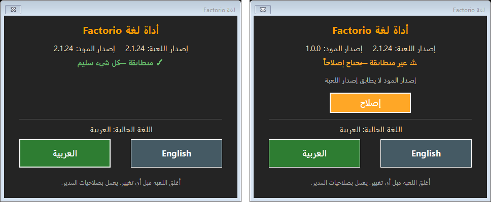
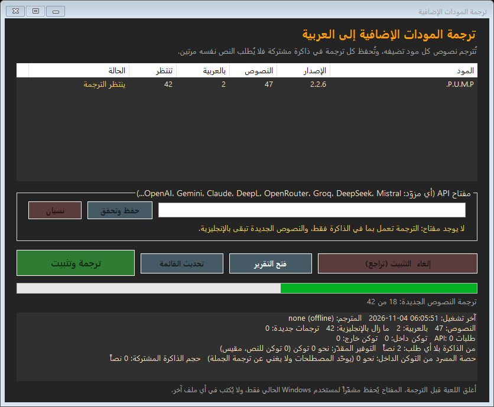
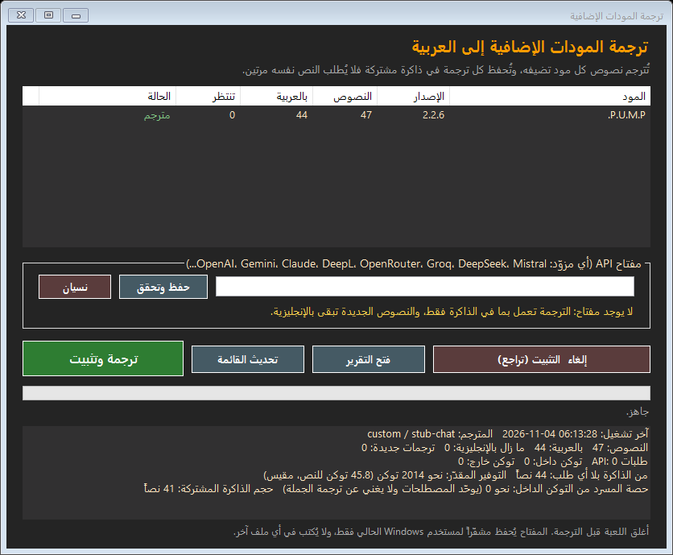
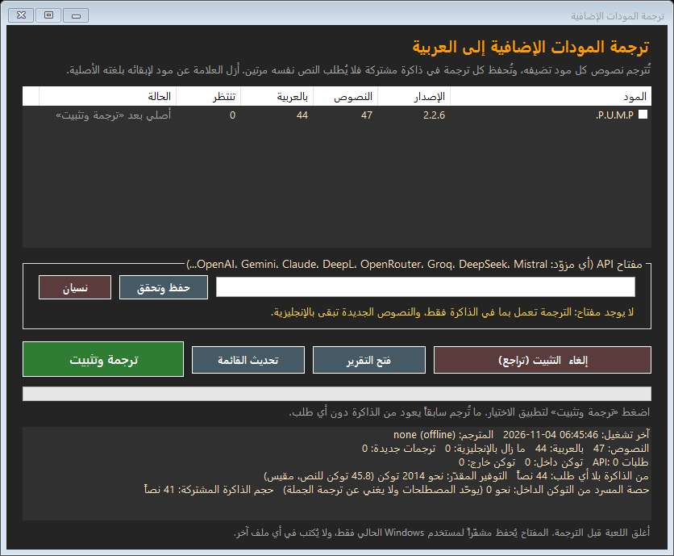
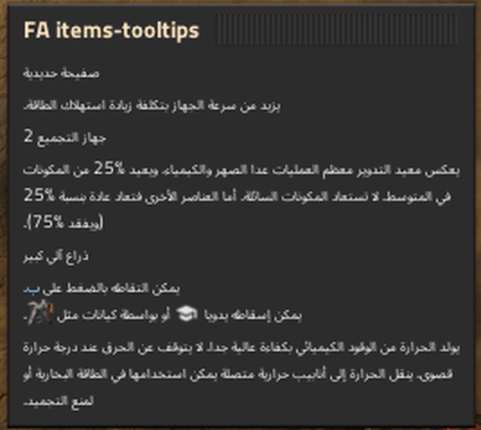
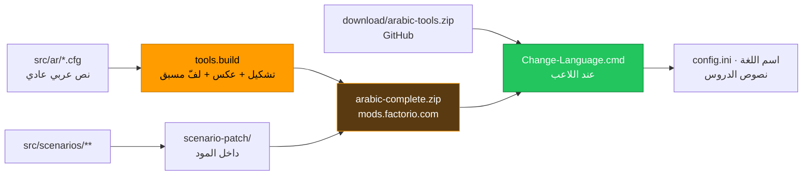

<div align="center">


**🧩 المود على موقع Factorio الرسمي: [mods.factorio.com/mod/arabic-complete](https://mods.factorio.com/mod/arabic-complete)**

[](https://mods.factorio.com/mod/arabic-complete)
[](https://factorio.com)
[](#-الملخص)
[](tests)
[](https://github.com/F2lcon01)

**تعريب كامل للعبة Factorio وتوسعة عصر الفضاء، بحروف متصلة واتجاه قراءة صحيح.**

<br>

[](https://github.com/F2lcon01/factorio01/raw/main/download/arabic-tools.zip)
[](https://github.com/F2lcon01/factorio01/releases/latest/download/arabic-mods-translator.zip)
[](https://mods.factorio.com/mod/arabic-complete)

</div>

---

## 📋 الفهرس

| # | القسم | المحتوى |
|:-:|---|---|
| 1 | [🎮 للاعبين](#-للاعبين) | التثبيت خطوة بخطوة، وأداة اللغة وزر «إصلاح» |
| 2 | [🌐 ترجمة المودات الإضافية](#-ترجمة-المودات-الإضافية) | أي مود تضيفه بالعربية، بذاكرة ترجمة لا تطلب النص مرتين |
| 3 | [🏆 لماذا هذا المود](#-لماذا-هذا-المود) | الفرق عن الترجمة العربية الحالية في اللعبة |
| 4 | [🔬 كيف يعمل](#-كيف-يعمل) | لماذا الحروف متصلة والأسطر مرتبة |
| 5 | [🔧 للمطورين](#-للمطورين) | خط الإنتاج والنشر والتحديث والاسترجاع |
| 6 | [📏 الحدود](#-الحدود) | ما لا يستطيع أي مود تغييره |
| 7 | [📈 الملخص](#-الملخص) | الأرقام |

---

## 🎮 للاعبين

> [!NOTE]
> **أداة اللغة مؤقتة**: إلى أن تصدر شركة Wube ترجمة عربية رسمية تعرض الحروف متصلة.
> موقع المودات لا يسمح بملفات تشغيل داخل أي مود، لذلك تُنزَّل الأداة من هنا. أما نصوص الدروس المصلحة
> فهي داخل المود، والأداة تأخذها منه، فتبقى مطابقة لإصدار المود دائماً.

### ▶️ التثبيت خطوة بخطوة

1️⃣ **ثبّت المود** من داخل اللعبة: **Mods ← Install ←** ابحث عن `arabic-complete` **← Install**، ثم **أغلق اللعبة**.

2️⃣ **نزّل الأداة**: [arabic-tools.zip](https://github.com/F2lcon01/factorio01/raw/main/download/arabic-tools.zip)،
ثم انقر عليها بالزر الأيمن ← **«استخراج الكل» (Extract All)**.

3️⃣ **شغّلها**: افتح المجلد وانقر مرتين على **`Change-Language.cmd`**.
إن ظهرت رسالة زرقاء «Windows protected your PC» فاضغط **«مزيد من المعلومات» ← «تشغيل على أي حال»**،
ثم **«نعم»** لصلاحيات المسؤول.

4️⃣ **اختر** **العربية** أو **English**. إن ظهر زر **«إصلاح»** فاضغطه. ثم افتح اللعبة.

> [!NOTE]
> **رقم الإصدار ظاهر دائماً.** رقم الأداة يظهر في شريط العنوان، ويظهر في سطر تحت إصدار المود. عند فتح النافذة تسأل
> الأداة GitHub وموقع المودات عن آخر إصدار، ثم تعرض واحدة من حالتين:
> - **«✓ الأداة والمود بآخر إصدار»**.
> - **«⬆ أداة أحدث: …»** أو **«⬆ مود أحدث: …»**، والسطر رابط يفتح صفحة التنزيل.
>
> لا تُرسل أي بيانات عنك. أداة اللغة وأداة الترجمة تحملان الرقم نفسه لأنهما تُنشران معاً.

<div align="center">



*على اليسار: كل شيء متطابق. على اليمين: المود أقدم من اللعبة، فيظهر زر «إصلاح».*

</div>

### 🔄 ماذا يفعل زر «إصلاح»

| المشكلة | ما تفعله الأداة |
|---|---|
| 🟡 إصدار المود لا يطابق إصدار اللعبة | تسأل موقع المودات: إن وُجد إصدار أحدث تفتح صفحته لتحدّثه من **Mods ← Updates**؛ وإلا تخبرك أن المود يعمل |
| 🔴 المود غير متوافق (مثلاً لعبة 2.2) | تخبرك بانتظار تحديث المود |
| 🔴 المود غير مثبت | ترشدك إلى **Mods ← Install** وتفتح صفحة المود |
| 🟡 المود معطّل | تفعّله |
| 🟡 اسم «العربية» مقطّع في قائمة اللغات | تصلحه |
| 🟡 Steam أعاد نصوص الدروس الأصلية بعد تحديث | تعيد ترقيعها، بعد حفظ الأصل احتياطياً |

> [!TIP]
> **بعد كل تحديث للعبة** شغّل الأداة مرة أخرى. لا تحتاج إلى تنزيلها من جديد.
> النسخ الاحتياطية في `%APPDATA%\Factorio\arabic-tools-backup`.

<details>
<summary><b>❓ أسئلة شائعة</b></summary>

| السؤال | الجواب |
|---|---|
| ظهرت «أغلق اللعبة أولاً» | أغلق Factorio تماماً ثم أعد المحاولة. اللعبة تحفظ إعداداتها عند الإغلاق |
| هل تغيّر الأداة شيئاً في حفظ ألعابي؟ | لا. تغيّر فقط لغة اللعبة، وملفات نصوص الدروس، واسم اللغة |
| كيف أرجع كل شيء كما كان؟ | اضغط «English»، ثم من Steam: كليك يمين على Factorio ← خصائص ← الملفات المثبتة ← التحقق من سلامة ملفات اللعبة |
| بلا الأداة؟ | الإعدادات ← الواجهة ← اللغة ← **العربية**. يعمل المود، لكن اسم اللغة ونصوص الدروس تبقى بلا إصلاح |
| «Couldn't get Steam auth ticket» | ليست من المود. أغلق Steam كلياً وأعد فتحه |

الشرح الكامل للمبتدئين: [`mod/README-AR.txt`](mod/README-AR.txt) · تغيير اللغة بالتفصيل: [`LANGUAGE.md`](LANGUAGE.md)

</details>

---

## 🌐 ترجمة المودات الإضافية

أي مود تضيفه تظهر نصوصه بالإنجليزية، لأن هذا المود يترجم اللعبة الأساسية فقط، واللعبة تعرض الإنجليزية لكل نص لا تجد
له عربية. **أداة ترجمة المودات** تولّد على جهازك مود ترجمة اسمه `arabic-mods-local` لكل مودّاتك المفعّلة، بحروف متصلة
وأسطر مرتبة كبقية اللعبة، وتحفظ كل ترجمة في **ذاكرة مشتركة** فلا تدفع ثمن النص نفسه مرتين.

### ▶️ الاستخدام (لا يحتاج تثبيت Python)

1️⃣ **نزّل** [arabic-mods-translator.zip](https://github.com/F2lcon01/factorio01/releases/latest/download/arabic-mods-translator.zip)
(نحو 12 ميغا، وفيه Python مدمج) ← زر أيمن ← **«استخراج الكل»**.

2️⃣ **شغّل** `Translate-Mods.cmd`، أو زر **«ترجمة المودات الإضافية...»** في نافذة أداة اللغة. لا يطلب صلاحيات المدير.

3️⃣ **مفتاح مجاني:** اضغط **«احصل على مفتاح مجاني»**. يفتح الزر صفحة المفاتيح الرسمية في متصفحك:
- **Google AI Studio**: هي الافتراضية، و**Google Gemini (مجاني)** مختار مسبقاً في القائمة.
- **OpenRouter**: إن اخترته من القائمة.

أنشئ المفتاح هناك بنفسك، ثم الصقه في النافذة ← **«حفظ وتحقق»**.

مع **«OpenRouter: نماذج مجانية فقط»** لا تستعمل الأداة إلا النماذج التي سعرها صفر. مفتاح OpenRouter في وضع «تلقائي»
يذهب إليها أيضاً. للنماذج المدفوعة اختر «OpenRouter: كل النماذج».

تقبل الأداة أيضاً مفاتيح OpenAI وAnthropic Claude وDeepL وGroq وDeepSeek وMistral وxAI وTogether وHugging Face
وCerebras وFireworks وNVIDIA. **المفتاح لا يُرسل إلا إلى المزوّد الذي اخترته**، ويُحفظ مشفّراً لمستخدم Windows الحالي
فقط. وبلا أي مفتاح: «خادم محلي مجاني (Ollama)» مع رابط الخادم.

حين يكون النموذج مزدحماً أو متوقفاً، أو حين تبلغ حدّه المجاني، ينتقل المترجم وحده إلى النموذج البديل التالي.

4️⃣ **«ترجمة وتثبيت»** ← افتح اللعبة.

5️⃣ **مود تريده بلغته الأصلية؟** أزل العلامة بجانبه ثم «ترجمة وتثبيت». تبقى بقية المودات عربية، وتبقى ترجماته
محفوظة: إعادة العلامة تعيده إلى العربية من الذاكرة **دون أي طلب**.

<div align="center">

| أثناء الترجمة | بعد التشغيل الثاني | مود بلغته الأصلية |
|:-:|:-:|:-:|
|  |  |  |

*اللقطتان الثانية والثالثة من قياس بمزوّد اختبار محلي يعدّ الطلبات: المود «مترجم»، و0 طلبات API، و44 نصاً من الذاكرة؛
ثم أُزيلت علامة P.U.M.P. ليبقى بلغته الأصلية.*

</div>

### 🧠 من أين تأتي كل ترجمة

| الترتيب | المصدر | الكلفة |
|:-:|---|:-:|
| 0 | مود أزلت علامته (أو نص تصحيحه `null`) يبقى بلغته الأصلية | 0 |
| 1 | تصحيحك اليدوي (`modpack_overrides.json`) | 0 |
| 2 | العربية التي يشحنها المود نفسه، بعد إصلاح اتجاهها وتشكيلها | 0 |
| 3 | الأسماء والاختصارات (مثل `P.U.M.P.`) تبقى كما هي | 0 |
| 4 | ترجمتنا للعبة الأساسية (نحو 6,800 نص) | 0 |
| 5 | **الذاكرة المشتركة**: كل نص تُرجم مرة، في أي مود | 0 |
| 6 | طلب API: النصوص الجديدة فقط، كل نص فريد مرة واحدة، مع المسرد المطابق | توكن |

> [!IMPORTANT]
> **مود لم يتغيّر لا يُرسل عنه أي طلب.** تحديث المود من مطوّره يرسل نصوصه الجديدة أو المتغيّرة فقط.
> **المسرد** (مثل water ← مياه) يوحّد المصطلحات لكنه **يضيف** توكن إلى كل طلب، ولا يغني عن ترجمة الجملة؛
> لذلك تُرسل منه المصطلحات الموجودة في الدفعة فقط (60 حداً أقصى)، وتعرض الأداة حصته من التوكن.

**مقيس:** على P.U.M.P. (47 نصاً) من الحزمة المفكوكة بـ Python المدمج:

| التشغيل | طلبات API | النتيجة |
|---|:-:|---|
| الأول | 2 | 44 نصاً بالعربية (2 من ذاكرة اللعبة، و42 مترجمة)، و3 أسماء كما هي |
| الثاني | **0** | الحالة «مترجم»، و44 نصاً من الذاكرة |
| داخل المحرك | — | نصوص المود عربية، و`Checksum of arabic-mods-local: 0` |

كل ترجمة تمر بفحص الرموز والوسوم وصيغ الجمع، وما يفشل يبقى بالإنجليزية ويُذكر في التقرير، مع تنبيهات الجودة
(مصطلح لم يُستخدم، أو ترجمة أطول بكثير من الأصل)، وقائمة بما أُخذ من الذاكرة لسياق آخر لمراجعته.

<details>
<summary><b>للمطورين</b></summary>

```powershell
powershell -NoProfile -ExecutionPolicy Bypass -STA -File .\Translate-Mods.ps1              # النافذة
powershell -NoProfile -ExecutionPolicy Bypass -File .\tools\translate_mods.ps1             # بلا نافذة (-Offline -ResetKey -Uninstall)
python -E -m tools.modpack status                     # حالة كل مود، دون أي طلب
python -E -m tools.modpack summary                    # آخر تشغيل: الطلبات والتوكن والتوفير
python -E -m tools.modpack export-tmx memory.tmx      # الذاكرة بصيغة TMX لأي أداة ترجمة
python -E -m tools.modpack original pump              # إبقاء مود بلغته الأصلية (arabic pump يعيده)
python -E -m tools.bundle translator                  # dist/arabic-mods-translator.zip (Python مدمج بهاش ثابت)
```

التصميم: [`docs/superpowers/specs/2026-11-04-mods-translator-gui-design.md`](docs/superpowers/specs/2026-11-04-mods-translator-gui-design.md) ·
التفاصيل: [`LANGUAGE.md`](LANGUAGE.md).

</details>

**English:** a translator for any other mod you install (Windows). Download
[arabic-mods-translator.zip](https://github.com/F2lcon01/factorio01/releases/latest/download/arabic-mods-translator.zip)
(embedded Python, nothing to install) and run `Translate-Mods.cmd`.

1. **Get a key.** *Get a free key* opens the official key page, Google AI Studio by default or OpenRouter. You create the key yourself and paste it into the window. You can also paste a key from any provider: OpenAI, Gemini, Claude, DeepL, OpenRouter (free models only by default), Groq, DeepSeek, Mistral or xAI.
2. **Press Translate.** A busy model hands over to a fallback on its own. It builds a local locale mod,
`arabic-mods-local`, shaped like the rest of the game. A shared translation memory means an unchanged mod costs no
request and an updated mod only sends its new strings (measured: first run 2 requests, second run 0). Untick a mod to
keep it in its original language; tick it again and it comes back from the memory with no request.

Both tools show their version in the title bar. Each time a window opens, it asks GitHub and the mod portal whether the tool or the mod has a newer release.

---

## 🏆 لماذا هذا المود

محرك Factorio لا يعرف تشكيل الحروف العربية ولا الكتابة من اليمين لليسار، فتظهر الترجمة العربية الموجودة في اللعبة
بحروف منفصلة ومقلوبة. هذا المود يقدّم النص جاهزاً للمحرك.

| الجانب | العربية الحالية في اللعبة | هذا المود |
|---|:-:|:-:|
| **الحروف** | 🔴 منفصلة | 🟢 **متصلة** |
| **اتجاه القراءة** | 🔴 مقلوب | 🟢 **من اليمين لليسار** |
| **الأوصاف الطويلة** | 🔴 ترتيب الأسطر مقلوب | 🟢 **من الأعلى للأسفل** |
| **التغطية** | 🔴 2,410 نصاً بالإنجليزي | 🟢 **7,600 نص كلها عربية** |
| **الجودة** | 🔴 392 نصاً فيها رموز مكسورة أو أسطر معكوسة أو مصطلحات غير موحّدة | 🟢 **مصحّحة** |
| **الدروس والسيناريوهات** | 🔴 منفصلة | 🟢 **مصلحة بالأداة** |
| **بيانات اللعبة** | — | 🟢 **لا تتغيّر** (checksum = 0) |

<div align="center">



*لقطة من داخل محرك اللعبة: حروف متصلة، وأسطر مرتبة من الأعلى للأسفل.*

</div>

---

## 🔬 كيف يعمل



| المشكلة في المحرك | الحل |
|---|---|
| لا يشكّل العربية ولا يعرف اليمين لليسار | نبني النص بأشكال العرض المتصلة (Presentation Forms) ونعكسه سطراً سطراً |
| اللفّ التلقائي يقلب ترتيب الأسطر | نلفّ مسبقاً بالبكسل (`WRAP = 460`، معايَر داخل اللعبة على عرض التلميح) |
| المود لا يصل إلى نصوص السيناريوهات (مُثبت) | `scenario-patch/` داخل المود، تطبّقها الأداة مع نسخة احتياطية |
| موقع المودات يرفض ملفات التشغيل داخل المود | الأداة على GitHub، والبيانات داخل المود |

الأدلة: `reports/spike.md`، `reports/verify-game.md`. السجل الكامل لكل قرار واكتشاف: [`docs/DEVLOG.md`](docs/DEVLOG.md).

---

## 🔧 للمطورين

`src/ar/*.cfg` و`src/scenarios/**` نص عربي **منطقي عادي** (كما يُكتب). لا تحرّر ملفات `dist/` أبداً.

<details open>
<summary><b>خط الإنتاج (بالترتيب)</b></summary>

```powershell
python -E -m tools.import_official          # الرسمي → منطقي + work/todo.jsonl
python -E -m tools.glossary --apply-decisions # توحيد المصطلحات (glossary_decisions.json)
python -E -m tools.terms apply              # أسماء النماذج المترجمة مرة واحدة
python -E -m tools.batches                  # تقسيم الباقي
python -E -m tools.merge NNN                # لكل دفعة مترجمة
python -E -m tools.corrections              # term_migrations + corrections.json + قاعدة الجمع + أرقام لاتينية + سولفيج
python -E -m tools.lint                     # يجب: errors=0
python -E -m pytest                         # كل الاختبارات
python -E -m tools.verify_game 2.1.24       # داخل المحرك: english=0 unshaped=0
python -E -m tools.visual_check 2.1.24      # لقطات شاشة حقيقية → reports/screens
python -E -m tools.build 2.1.24             # dist/arabic-complete_2.1.24
powershell -NoProfile -File tools\install.ps1 -Version 2.1.24   # تثبيت + تفعيل (نسخة احتياطية لـ mod-list.json)
python -E -m tools.scenarios build; python -E -m tools.scenarios apply   # رقعة السيناريوهات
python -E -m tools.scenario_check           # المحرك يقرأ نص السيناريو المرقّع (بلا نافذة وبلا Steam)
```

> [!IMPORTANT]
> التثبيت بـ PowerShell لا Python: نسخة Python من Microsoft Store تحوّل كتاباتها تحت `%APPDATA%`
> إلى نسخة خاصة لا تراها اللعبة (مُثبت). `tools/install.py` يرفض عمداً ويشير إلى `install.ps1`.

</details>

<details>
<summary><b>النشر</b></summary>

رقم إصدار المود = رقم إصدار اللعبة.

```powershell
python -E -m tools.package 2.1.24                                   # zip المود + Crowdin + download/arabic-tools.zip
pwsh -NoProfile -File tools\publish.ps1 -Version 2.1.24 -DryRun     # فحص محلي
pwsh -NoProfile -File tools\publish.ps1 -Version 2.1.24 -Update     # إصدار جديد؛ يطلب المفتاح بإدخال مخفي
```

- قبل كل إصدار: أضف قسماً في `mod/changelog.txt` (يفحص `tools.package` صيغته).
- الموقع يرفض أي ملف تنفيذي داخل المود (`InvalidModUpload`)، و`tools.package` و`publish.ps1` يرفضانه قبل الرفع.
- إن تغيّر `download/arabic-tools.zip` فارفعه إلى GitHub مع الإصدار.

</details>

<details>
<summary><b>بعد كل تحديث للعبة</b></summary>

```powershell
powershell -NoProfile -ExecutionPolicy Bypass -File .\tools\auto_update.ps1   # يعيد البناء برقم اللعبة ويثبّت ويفحص
python -E -m tools.sync                     # مفاتيح جديدة/متغيرة → work/todo.jsonl
# ترجمة → merge → lint → pytest → verify_game → package → publish
python -E -m tools.sync --refresh-snapshot
python -E -m tools.scenarios status         # إن ظهر 'other' فالتحديث استبدل الملفات: أعد build + apply
```

التفاصيل والجدولة التلقائية: [`LANGUAGE.md`](LANGUAGE.md).

</details>

<details>
<summary><b>الاسترجاع</b></summary>

```powershell
powershell -NoProfile -File tools\install.ps1 -Uninstall   # تعطيل + نقل المود إلى %APPDATA%\Factorio\mods-parked (لا حذف)
python -E -m tools.scenarios restore     # إعادة ملفات السيناريو الأصلية بايتاً بايتاً (مُختبر على اللعبة الحقيقية)
```

أو من Steam: «التحقق من سلامة ملفات اللعبة» يعيد ملفات السيناريو الأصلية.

</details>

---

## 📏 الحدود

> [!WARNING]
> لا يستطيع أي مود تغيير هذه: محاذاة النص لليسار · البحث بالعربي داخل اللعبة · نص الدردشة.

**استثناءات موثّقة:** 8 أسماء مكتوبة حرفياً في كود اللعبة نفسها (`localised_name = "dummy"` في `trains.lua`/`enemies.lua`،
وخطأ في `explosions.lua:7885`)، وهي كيانات داخلية لا تظهر للاعب. مسجّلة في `tools/verify_game.py: EXCEPTIONS`.

---

## 📈 الملخص

<div align="center">

| النصوص | العدد | النسبة |
|---|:-:|:-:|
| 🟢 من الترجمة الرسمية كما هي (بعد التشكيل) | 4,798 |  |
| 🟡 مصحّحة | 392 |  |
| 🟠 جديدة (كانت بالإنجليزي) | 2,410 |  |
| **🔤 المجموع** | **7,600** |  |

| ✅ نصوص الدروس | 📖 المسرد | 🧩 الوحدات | 🛡️ الاختبارات |
|:-:|:-:|:-:|:-:|
| 691 نصاً في 23 ملفاً | 1,055 مصطلحاً | core · base · space-age · quality · elevated-rails · recycler | 86 |

</div>

---

<div align="center">

**Factorio Arabic v2.1.24**: F2lcon01

النص الأصلي للعبة © Wube Software. يبني على الترجمة العربية المجتمعية في مشروع Factorio على Crowdin.
معالجة هذا المشروع ونصوصه الجديدة والمصحّحة بترخيص MIT، كما هو مسجّل في صفحة المود.

[](https://github.com/F2lcon01)


</div>
